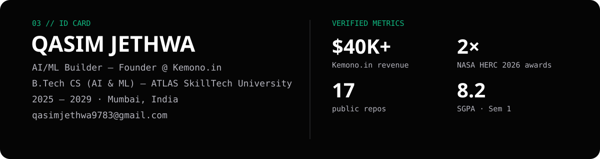
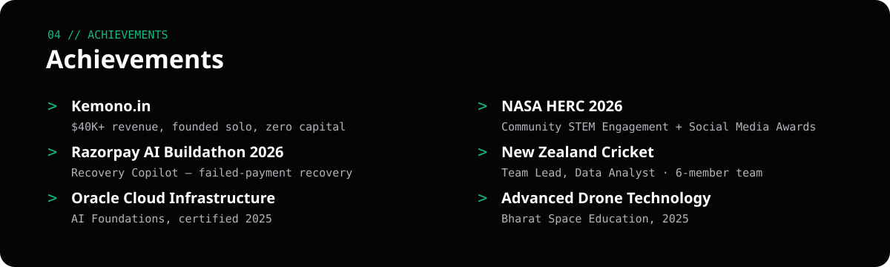

## `SYSTEM METRICS`

 

## `SELECTED WORK`

| Project | What it is | Stack |
| --- | --- | --- |
| **[Mumbai Flow](https://github.com/qasimjethwa/Traffic-management)** ⭐ | AI traffic management for Mumbai — real OSRM road data, FastAPI + PostGIS backend, provenance-labelled Data view. [Live](https://qasimjethwa.github.io/Traffic-management/) | React · FastAPI · PostGIS · OSRM |
| **[Recovery Copilot](https://github.com/qasimjethwa/Failed-payment-recovery)** | Rule-based failed-payment recovery engine — classifies failures, maps each to a retry strategy. Razorpay AI Buildathon 2026 | Python |
| **[RoverSense](https://github.com/qasimjethwa/roversense)** | ML anomaly detection for rover telemetry — Isolation Forest, 64 trees, precision 0.986 | Python · scikit-learn |
| **[First AI Agent](https://github.com/qasimjethwa/first-ai-agent)** | Zero-code agent studio — 10 working tools, 100% browser-side | JavaScript |
| **[SpamShield](https://github.com/qasimjethwa/spamshield)** | Explainable SMS spam classifier, calibrated, runs fully in the browser | Python · JavaScript |
| **[MandiLens](https://github.com/qasimjethwa/mandilens)** | Crop price forecasting for Indian farmers — walk-forward backtest, ensemble models | Java |

    
